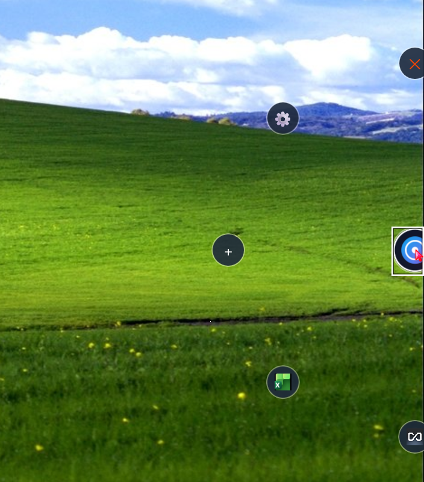
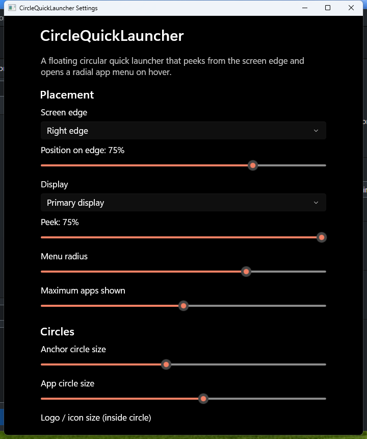
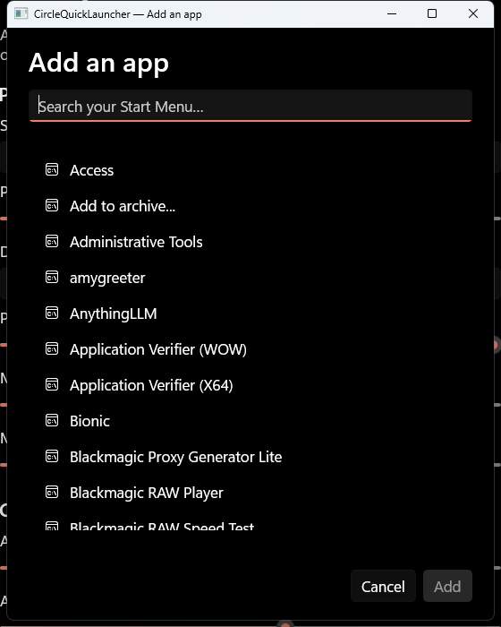

# CircleQuickLauncher

**A floating, edge-peeking circular quick launcher for Windows 10/11.** Hover the subtle circle docked at your screen edge and it fans out into a radial menu of your favorite apps — one glance, one click, no taskbar clutter.

[](https://github.com/deadbrainviv/CircleQuickLauncher/actions/workflows/ci.yml)
[](https://github.com/deadbrainviv/CircleQuickLauncher/releases)
[](LICENSE)
[!.NET](https://img.shields.io/badge/.NET-8.0-512BD4?style=flat-square&logo=dotnet)](https://dotnet.microsoft.com/)
[](https://www.microsoft.com/windows)

> **Keywords:** windows quick launcher, radial app launcher, circular dock, edge launcher, hover launcher, productivity, WinUI 3, open source

**Architected by** [deadbrain](https://github.com/deadbrainviv) · **Developed by** [CogniSynapseAI](https://github.com/CogniSynapseAI)

---

## Table of Contents

- [Features](#features)
- [Screenshots](#screenshots)
- [Download](#download)
- [Install](#install)
- [Usage](#usage)
- [Settings](#settings)
- [How It Works](#how-it-works)
- [Building from Source](#building-from-source)
- [Contributing](#contributing)
- [License](#license)

---

## Features

- **Edge-peeking anchor** — a small circular handle rests half-hidden at the screen edge (Left, Right, Bottom, or Free-floating).
- **Radial app menu on hover** — point at the handle and up to 12 app circles fan out along a smooth arc with staggered spring animation.
- **Hover zoom** — the anchor and app circles scale up smoothly (default 30%, configurable) with a fluid center-preserving animation.
- **Configurable edge position** — place the anchor anywhere along the chosen edge (default: 75% down the right edge).
- **Display selection** — stay on the primary display by default, or pick any connected monitor.
- **Custom PNG icons** — assign any PNG as an app's launcher icon; icons are validated (min dimensions, non-empty) and cached locally.
- **Start Menu integration** — browse and add installed apps from the Windows Start Menu with one click.
- **Search / filter** — click the anchor to open a search box; type to filter apps inside the expanded menu.
- **System tray resident** — lives in the notification area; no taskbar button. Right-click for Settings, Add App, and Exit.
- **Lightweight** — pure WinUI 3 / C# with no background services, no telemetry, no network calls. Config is local JSON.
- **Autorun option** — optional "Start with Windows" (registry Run key or MSIX StartupTask).
- **Multi-monitor aware** — DPI-aware placement and work-area math on per-monitor setups.
- **Crash-resilient** — unhandled exceptions are logged to `%APPDATA%\CircleQuickLauncher\logs\`; the app attempts single-instance recovery.

## Screenshots

| Fan expanded | Hover zoom |
| --- | --- |
|  |  |

| Settings | Add an app |
| --- | --- |
|  |  |

## Download

Grab the latest release from the [Releases page](https://github.com/deadbrainviv/CircleQuickLauncher/releases):

| Artifact | Best for |
| --- | --- |
| `CircleQuickLauncher-<ver>-portable-win-x64.zip` | Most users — self-contained, no install, no dependencies. |
| `CircleQuickLauncher-<ver>.msix` | Sideload package (enable Developer Mode or trust the cert). |
| `SHA256SUMS.txt` | Verify download integrity. |

**Requirements:** Windows 10 version 1809 (build 17763) or later, or Windows 11, **x64**. .NET runtime is bundled (self-contained).

## Install

### Portable (recommended)

1. Download and extract the `*-portable-win-x64.zip`.
2. Run `CircleQuickLauncher.exe`.
3. The anchor circle appears at the right screen edge; a tray icon appears in the notification area.

### Installer (Inno Setup)

Run `CircleQuickLauncher-Setup-<ver>.exe`. Options: desktop shortcut, start with Windows.

### MSIX

1. Enable **Developer Mode** (Settings → System → For developers) or trust the signing certificate.
2. Double-click the `.msix` or run `Add-AppxPackage CircleQuickLauncher-<ver>.msix`.

## Usage

| Action | Result |
| --- | --- |
| Hover the edge anchor | Radial menu expands. |
| Move pointer onto an app circle | Hover glow; click to launch. |
| Move pointer away | Menu collapses after the configured delay (default 400 ms). |
| Click the anchor (or press the search affordance) | Search box opens; type to filter apps. |
| Right-click the tray icon | Context menu: Settings, Add App, Exit. |
| Left-click the tray icon | Open Settings. |

## Settings

Open via tray → **Settings**. All values are persisted to `%APPDATA%\CircleQuickLauncher\settings.json` (schema-versioned, sanitized on load).

| Setting | Range | Default | Description |
| --- | --- | --- | --- |
| Screen edge | Left / Right / Bottom / Free-floating | Right | Which screen edge the anchor peeks from. |
| Position on edge | 0 – 100 % | 75 % | Where the anchor sits along the chosen edge. |
| Display | Primary / any connected display | Primary | Which monitor hosts the launcher. |
| Peek | 10 – 75 % | 25 % | How much of the anchor peeks out. |
| Menu radius | 70 – 400 px | 140 | Radius of the radial fan. |
| Maximum apps shown | 1 – 20 | 12 | Maximum app circles in the arc. |
| Anchor circle size | 32 – 128 px | 56 | Diameter of the anchor circle. |
| App circle size | 24 – 96 px | 48 | Diameter of each app circle. |
| Logo / icon size | 12 – 80 px | 32 | Diameter of the icon drawn inside each circle. |
| Hide delay | 0 – 5000 ms | 400 | Grace period before collapsing after pointer exit. |
| Hover zoom | 0 – 100 % | 30 % | How much circles scale up when hovered. |
| Start with Windows | on / off | off | Adds/removes an autorun entry. |

App list lives in `apps.json`; custom icons are copied into the `icons\` subfolder.

## How It Works

- **WinUI 3** (Windows App SDK 1.8) unpackaged, self-contained, single-window, borderless, tool-window + no-activate.
- **Window chrome**: `OverlappedPresenter.SetBorderAndTitleBar(false, false)`, `WS_EX_TOOLWINDOW | WS_EX_NOACTIVATE | WS_EX_NOREDIRECTIONBITMAP`, DWM frame extension, `WM_NCHITTEST` subclassing so only the circles accept hit-testing (else `HTTRANSPARENT`).
- **Layout math** is isolated in `CircleQuickLauncher.Core` (`ArcLayoutCalculator`, `WindowLayoutCalculator`) — pure, deterministic, and unit-tested (73 tests).
- **Config storage** uses atomic writes (`AtomicFile`) + versioned JSON with `Sanitize()` clamping.
- **Tray integration** via `Shell_NotifyIcon`; single-instance via named mutex + named pipe.
- **Animations**: WinUI Composition keyframe animations (opacity + scale) with per-item stagger; only run on already-visible elements.

## Building from Source

See [docs/BUILDING.md](docs/BUILDING.md) for full instructions. Quick start:

```powershell
# Prerequisites: .NET 8 SDK, Windows 10 SDK 17763+, Visual Studio 2022 (or VS Build Tools) with WinUI workload
git clone https://github.com/deadbrainviv/CircleQuickLauncher.git
cd CircleQuickLauncher
dotnet restore CircleQuickLauncher.sln
dotnet build CircleQuickLauncher.sln -c Release -p:Platform=x64
dotnet test tests/CircleQuickLauncher.Tests -c Release

# All release artifacts (portable zip + installer + MSIX):
.\scripts\Build-Release.ps1
```

## Contributing

Issues and PRs welcome. Please read [SECURITY.md](SECURITY.md) before reporting vulnerabilities.

- All new code should come with unit tests where practical (Core layout/validation is fully covered).
- Follow the existing code style (`.editorconfig` is configured; warnings-as-errors is off but keep the build clean).
- Do not introduce network calls, telemetry, or hidden data collection.

## License

[MIT](LICENSE) © CircleQuickLauncher Contributors.

---

**SEO / discoverability:** quick launcher, radial launcher, circular dock, edge dock, hover menu, productivity tool, Windows 11 launcher, WinUI 3 app, open-source launcher, .NET 8, x64, portable, no-install.
